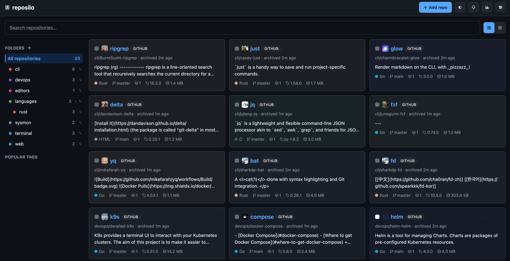
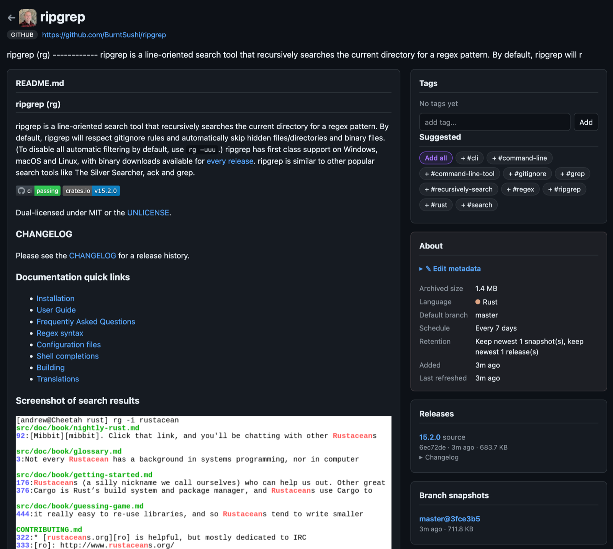
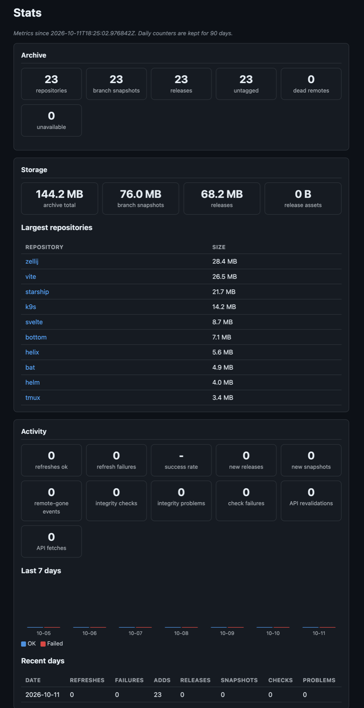

# reposilo

Self-hosted git repo archiver that saves and manages code repositories.

Each repo is kept as shallow snapshots and release tags (plain zips on
disk), so the archive is still browsable and searchable if the remote ever
goes away.

[](screenshots/reposilo-main.webp)

## What it does

- Keeps any git repo as a zip (or tar.zst) snapshot plus release tags, on a
  schedule you set, with per-repo retention.
- Edit one repo or a multi-selection from the same dialog: schedule, retention,
  tags, and card color. Set the schedule to `0` for archive-only repos that are
  never checked automatically (manual refresh still works).
- Snapshots stay browsable without unzipping (README, file listing, downloads),
  so a copy survives its remote. A repo unreachable for three weeks is marked
  dead and stops being checked.
- Imports folders of zipped repos, detecting origins offline from `.git/config`,
  package manifests, and READMEs, with GitHub search and llama.cpp as fallbacks.
- Organizes with tags, folders, and search, plus language detection and optional
  llama.cpp auto-tagging.
- Notifies on new releases with the changelog, supports an optional webhook, and
  can download release binaries for the platforms you choose.
- Verifies the archive on demand or on a schedule, hashing every zip against its
  sidecar to catch missing or corrupt files.
- Paces outbound requests per host and revalidates API responses with ETag, so
  refreshing many repos does not trip forge rate limits.

[](screenshots/reposilo-repo.webp)

## On disk

```
<archive_root>/<owner>-<repo>/
├── repo.json        # origin, tags, schedule, retention
├── README.md        # plain README of the default branch
├── branch/<branch>/ # one zip per snapshot, plus a JSON sidecar
└── releases/<tag>/  # one zip per release, plus a JSON sidecar
    └── assets/       # release binaries, when enabled
```

- A repo folder holds `repo.json`, a `README.md`, and one zip per snapshot or
  release. Nothing else. Refreshing clones the remote into a temp directory,
  writes the zip with `git archive`, then deletes the clone.
- Each zip has a `.json` sidecar (commit, ref, version, size, sha256), and carries
  the same metadata inside it as `.reposilo.json`, so a zip copied anywhere is
  still self-describing.
- Filenames start with the project name, for example
  `ripgrep-master@2025-01-15_a1b2c3d.zip`.
- The tree is the source of truth. Delete the index and `reposilo reindex`
  rebuilds it from the files on disk.
- Snapshots are zips, or `tar.zst` when configured.
- Imported zips keep their original filenames and are never pruned.
- When a release tag points at the same commit as the branch HEAD, the two
  snapshots share one file through a hard link. Each sidecar still records its
  own kind, ref, and version.

## Install

Grab a prebuilt binary from the
[releases page](https://github.com/marcsnid/reposilo/releases), or build from source:

```sh
cargo build --release
```

The only runtime dependency is `git`.

## Usage

```sh
# setup
reposilo init --root /path/to/archive
reposilo user add yourname --password <pw>   # optional: enable login

# add + manage repos
reposilo add https://github.com/BurntSushi/ripgrep.git --tag cli --tag rust
reposilo list --tag cli --tag rust
reposilo refresh all                         # pull new snapshots/releases
reposilo reindex --catalog                    # stats + catalog.json
reposilo verify                               # hash every zip against its sidecar

# import a zip collection
reposilo import /path/to/zips --dry-run       # preview (touches nothing)
reposilo import /path/to/zips --copy --tag imported

# migrate an old archive to the current layout
reposilo migrate-folders                     # owner/repo → owner-repo folders
reposilo prune-shallow                       # remove old git stores (zip-only)
reposilo migrate --dry-run                   # preview schema migrations
reposilo migrate                             # backfill card colors + icons

# start the web UI + API + scheduler
reposilo serve                               # 127.0.0.1:8765 by default
reposilo serve --bind 0.0.0.0:8765           # or REPOSILO_BIND=0.0.0.0:8765
# GET /healthz is an unauthenticated liveness probe (200 while the server is up)
# open http://127.0.0.1:8765:
#   - search, tag-filter, browse repos with rendered READMEs
#   - create and manage folders (any nesting depth, emoji icons or colored dots);
#     drag cards onto a folder to move repos between them
#   - select repos with the checkboxes to refresh, tag, move or remove them in bulk
#   - edit metadata (name, description, notes, origin, folder, tags) per repo
#   - import zips from Settings; assign origins to _unknown repos
#   - notifications with readable release changelogs, deep links to the exact
#     release/snapshot, kind filter tabs with past-week counts, and a divider
#     between this week and older items
#   - verify the whole archive from Settings (hashes every zip)
#   - dark/light theme, settings (retention, scheduler, llama.cpp)
#   - a REST API; downloads stream straight from disk
```

```sh
# AI auto-tagging (needs llama.cpp configured in Settings)
reposilo autotag --dry-run                   # preview suggested tags
reposilo autotag                             # apply (merges, never removes)
```

### Configuration

The config file lives at `~/.config/reposilo/config.toml` (or `--config`).
Every key, with its default and a short comment, is listed in
[`docker/config.example.toml`](docker/config.example.toml). The Settings page
in the web UI covers most of the common options at runtime.

### Stats and monitoring

Every instance has a built-in Stats page (`/stats`, also in the top bar) and a
JSON API at `/api/stats`. It shows totals (repos, snapshots, releases, dead and
unavailable remotes, untagged), a storage breakdown with the ten largest repos, a
7-day refresh chart, integrity check counts, API cache stats, and live
rate-limit status. Counters persist to `<archive>/metrics.json` for 90 days, so
they survive restarts.

<a href="screenshots/reposilo-stats.webp"></a>

For longer-lived history, set `[otel] enabled = true` to also export over
OTLP/HTTP to a collector. The three signals are independent:

- Logs: Everything `tracing` emits, bridged through the OpenTelemetry log appender. Log
records from the exporter's own HTTP stack are filtered out to avoid a feedback
loop.
- Traces: One span per HTTP request, plus spans for add, refresh, and integrity check jobs.
- Metrics: The same totals and counters as the Stats page, plus gauges.

### Users and auth

Auth is opt-in. Without `users.json` in the archive root, everything is open
(backwards compatible). Add users to require login:

```sh
reposilo user add alice --password <pw>   # or REPOSILO_PASSWORD env var
reposilo user list
reposilo user remove alice
```

Sessions are 7-day cookies; logout clears them. The CLI can manage users
while the server is running (hot-reload).

Auth **fails closed**: if `users.json` exists but is unreadable or corrupt,
the server stays locked (logins are rejected) instead of silently opening up.
Fix the file to restore access. Deleting it entirely disables auth again.

## Docker

A two-stage `Dockerfile` builds a static musl binary and drops it into a
minimal Alpine runtime. The runtime is Alpine rather than `scratch` because
the archiver shells out to `git`, which is not statically linked.

```sh
docker build -t reposilo .
```

Or use the example stack:

```sh
cp docker/config.example.toml docker/config.toml   # edit archive, platforms, tokens
docker compose up -d
```

The app speaks plain HTTP on port 8765; run a reverse proxy in front and keep
the published port on `127.0.0.1`. Prebuilt images live on GHCR at
`ghcr.io/marcsnid/reposilo`: `latest` plus a `YYYYMMDD` snapshot on every
`main` push, and the version tags on `v*` tags. The compose file runs the
container read-only with all capabilities dropped and only `/config`,
`/archive` and `/tmp` writable.

If you clone over SSH instead of HTTPS, add `openssh-client` to the runtime
stage and mount your keys. The container sets `REPOSILO_BIND=0.0.0.0:8765`
(override with `-e REPOSILO_BIND=...`).

## Development

```sh
cargo build --release
cargo test
cargo clippy --all-targets -- -D warnings
```

### Testing strategy

`cargo test` runs everything, and nothing reaches the public internet. The
layers are:

- Unit tests sit next to the code: config parsing, payload parsers, the
  governor and cache internals, view mapping, and the verify engine.
- `tests/integration.rs` drives the archiver against real local `file://` git
  remotes: add, refresh, retention, dedup, and asset handling.
- `tests/import.rs` covers importing zip collections, including detection and
  origin assignment.
- `tests/web.rs` drives the HTTP UI and API against a real in-process server,
  including bulk actions and a real local clone.
- `tests/ratelimit.rs` runs the governor and conditional cache against a local
  HTTP server: spacing, backoff, the rate-limit header families, ETag
  revalidation, and git operation pacing.
- `tests/traces.rs` exports a span to a mock OTLP collector.
- `tests/api.rs` covers the JSON API.

CI runs the same test suite plus `clippy -D warnings` and a dependency audit.

Single binary (templates + CSS + htmx compiled in). No external services
required except git and optionally a llama.cpp endpoint for AI tagging.

## License

MIT. See [LICENSE](LICENSE).
